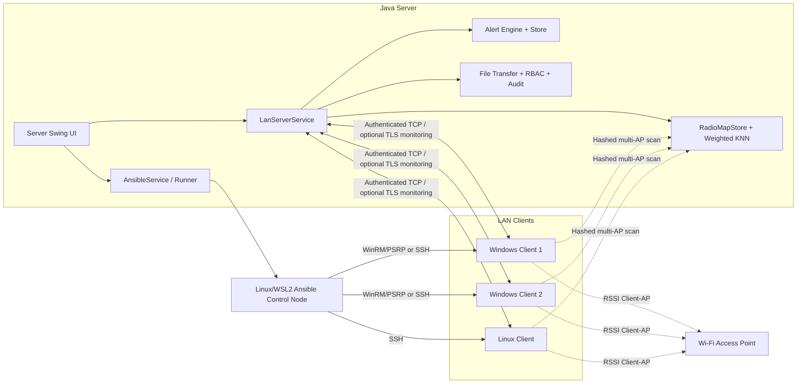
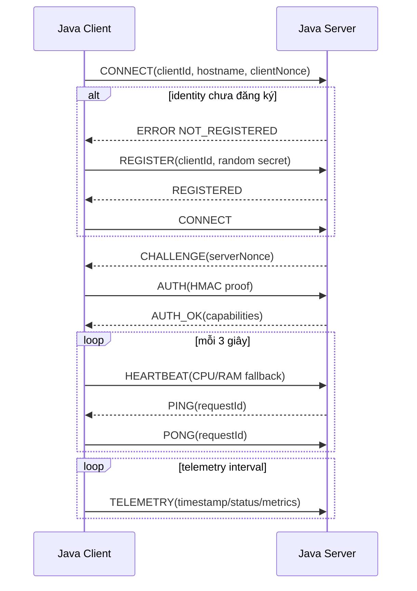
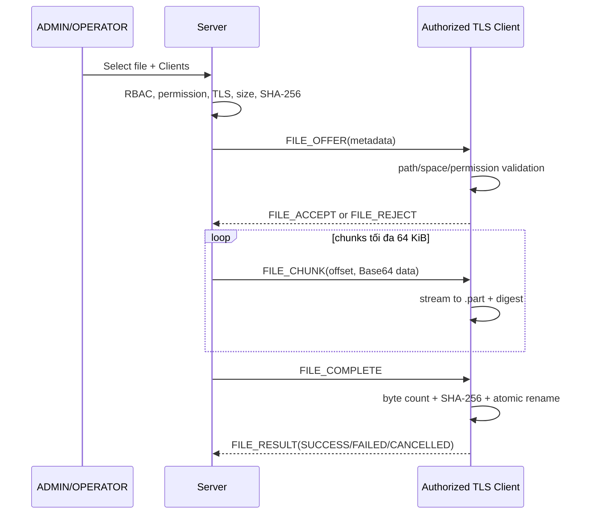
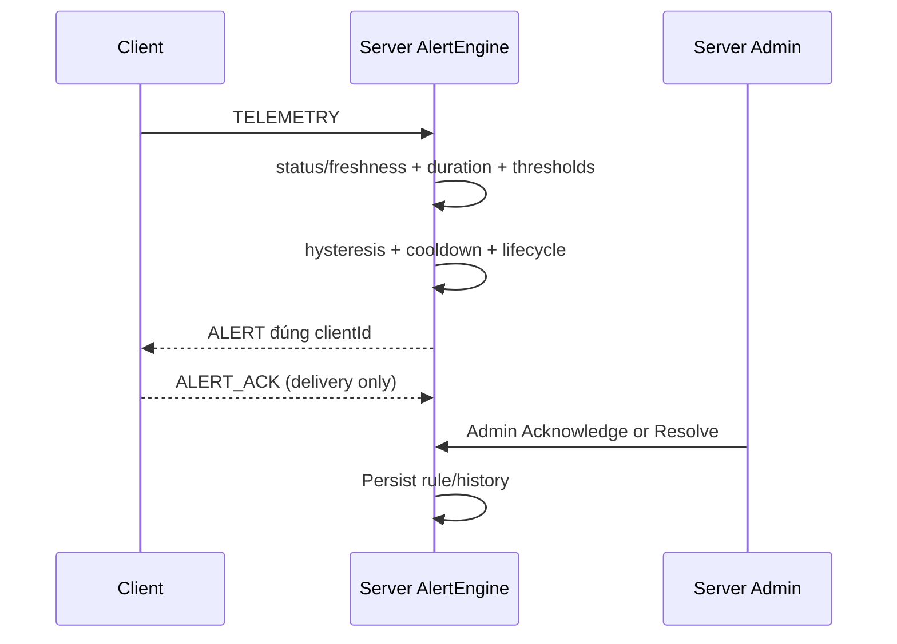
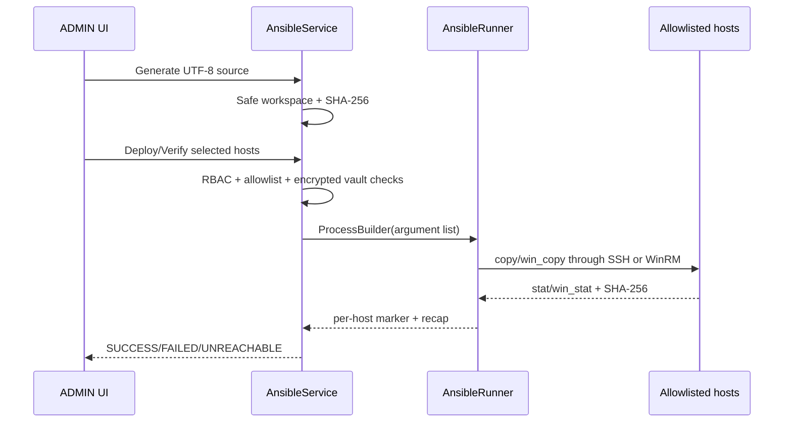

# Kiến trúc hệ thống và sơ đồ

## Thành phần

Java Client online không tự động trở thành Ansible managed host. Ansible dùng allowlist/credential riêng. RSSI trong sơ đồ là Client–AP, không phải Server–Client.

## CONNECT, authentication và heartbeat

## File Transfer

## Resource Alerting

`ALERT_ACK` không đồng nghĩa Admin Acknowledge.

## Ansible synchronization

## Threading model

- Swing components are mutated on the EDT.
- Accept/read/connect/reconnect and file transfer use named daemon executors.
- Heartbeat, telemetry, Wi-Fi sampling and system inventory use separate executors so an OS probe does not block connectivity.
- Connected-AP monitoring and opt-in multi-AP fingerprint scanning use separate schedulers. A Wi-Fi
  fingerprint is realtime-eligible only while status is `OK`, its TTL is valid and the Client is connected.
- TLS deployment separates the mutable TCP endpoint (current LAN IPv4 entered in the Client) from a stable
  certificate DNS identity. The Client connects the raw socket to the IPv4, then layers TLS using the stable
  identity for SNI and endpoint verification; no DNS lookup or hostname-verification bypass is used.
- `FramedConnection` serializes writes per socket, preventing interleaved frames.
- Dashboard coalesces Client updates every 250 ms; charts and histories have fixed bounds.
- Shutdown cancels schedules, closes sockets/streams and terminates executors. Final service close is idempotent.
